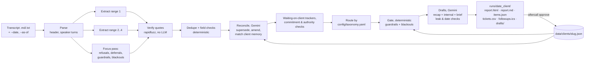

# aftercall

**aftercall turns a client call transcript into a reviewed, routed action list, and remembers each client across calls.** It reads a transcript in any language and any reasonable format and extracts every bug, config change, promise, client deliverable, refusal, deferral, guardrail and blackout window, each backed by a verbatim quote. It sorts them into tickets, a change checklist, a cross-client backlog and follow-ups. Every proposed action goes through a deterministic gate that checks the client's own rules ("don't enable Opel without me", "nothing new while I'm on vacation") and shows the quote behind every block. It drafts the recap email in the client's language, with no internal information in it. **Nothing runs on its own: aftercall prepares, a human approves.**

## Results: start here

Output for the attached transcript ([`transkrypcja-spotkanie.md`](transkrypcja-spotkanie.md)) is in [`runs/2026-10-06_auto-tama/`](runs/2026-10-06_auto-tama/):

- [`report.md`](runs/2026-10-06_auto-tama/report.md): the full review (actions by route, what the gate blocked, guardrails, superseded items). It renders on GitHub.
- [`drafts/recap_email.md`](runs/2026-10-06_auto-tama/drafts/recap_email.md): the recap email draft to the client, in Polish. Its known errors are listed under [Known issues](#known-issues).
- [`drafts/internal_notes.md`](runs/2026-10-06_auto-tama/drafts/internal_notes.md) and [`drafts/meeting_brief.md`](runs/2026-10-06_auto-tama/drafts/meeting_brief.md): internal-only notes, and the brief for the meeting with Paweł.
- [`tickets.csv`](runs/2026-10-06_auto-tama/tickets.csv), [`followups.ics`](runs/2026-10-06_auto-tama/followups.ics), [`items.json`](runs/2026-10-06_auto-tama/items.json): tickets, reminders as calendar events, and every extracted item with its quote.
- [`report.html`](runs/2026-10-06_auto-tama/report.html): the same review as an interactive page with tabs, a filter and Approve/Reject buttons. GitHub shows it as source, so clone the repo and open it locally, or run `uv run aftercall view runs/2026-10-06_auto-tama`.

A second, made-up call in English is in [`runs/2026-10-20_brightsmile-dental-clinics/`](runs/2026-10-20_brightsmile-dental-clinics/) (see [Runs on another call](#runs-on-another-call)). The design is in [`PLAN.md`](PLAN.md), every assumption is in [`ASSUMPTIONS.md`](ASSUMPTIONS.md), and the AI work logs are in [`transcripts/`](transcripts/).

## Pipeline



The parallel extraction calls, and the two draft calls, run concurrently. Everything marked deterministic is plain Python with no LLM, so its decisions can always be explained.

## Run it in 3 commands

```bash
uv sync && cp .env.example .env          # then put GEMINI_API_KEY (and optionally GEMINI_MODEL) in .env
uv run aftercall run transkrypcja-spotkanie.md --date 2026-10-06 --as-of 2026-10-19
uv run aftercall view runs/2026-10-06_auto-tama   # opens the review page in a browser
```

Shortcuts (`./ac help`): `./ac run <file>` analyses any transcript and opens the review page (it uses today's date if the file has none), `./ac paste` does the same for a transcript in the clipboard, `./ac approve` approves the latest run, and `./ac demo` / `./ac demo2` replay the two example calls.

Other commands:
- `aftercall approve <run_dir> --all | --ids …` commits approved items to client memory.
- `aftercall eval <run_dir> --gold eval/gold/auto-tama.yaml` scores a run.
- `aftercall client show <slug>` prints a client's stored memory.
- Flags for `run`: `--client <slug>` (defaults to a slug derived from the client name in the transcript) and `--no-cache` (forces new Gemini calls).

## Adding a client, changing the taxonomy

- **New client:** nothing to set up. Run the pipeline. The slug comes from the client name in the transcript, or from `--client`. `data/clients/<slug>.json` is created the first time you run `aftercall approve`.
- **Routing:** `config/taxonomy.yaml` maps each item type to one or more routes, and adds extra routes by action kind (e.g. a launch also goes on the change checklist).
- **Vendor-level settings** are in `config/settings.yaml`:
  - the vendor's org names and email domains (who counts as "us")
  - product areas (guardrails only block actions in the same area)
  - generic tags the gate ignores
  - recap leak words
  - per-prompt thinking budgets
  - the number of parallel extraction calls
- **Prompts** live in `prompts/*.md` and can be edited without touching code.

## Results (gold: `eval/gold/auto-tama.yaml`, 29 must-catch items, 15 traps)

All runs used `gemini-2.5-flash`, the Auto Tama transcript, and as-of 2026-10-19. Each batch is three consecutive runs with `--no-cache`.

| Code version | Run | Recall | Traps | Wall time |
|---|---|---|---|---|
| A: parallel extraction, tag-scoped blackouts | 1 | 28/29 (97%) | 14/15 | 74 s |
| | 2 | 29/29 (100%) | 12/15 | 89 s |
| | 3 | 29/29 (100%) | 14/15 | 85 s |
| B: blackouts as time windows (blocks the A/B and fresh-leads launches in all 3 runs) | 1 | 29/29 (100%) | 10/15 | 132 s |
| | 2 | 26/29 (90%) | 13/15 | 89 s |
| | 3 | 27/29 (93%) | 15/15 | 112 s |
| Final (B + output-size cuts, recap leak retry, authority rule) | 1 | 29/29 (100%) | 12/15 | not measured* |
| Final + recap accuracy rules (the committed `runs/2026-10-06_auto-tama`) | 1 | 29/29 (100%) | 13/15 | 71 s |

\* The final code got only one complete run, and its extraction responses came from cache. This is an honest gap: the three-run check was interrupted.

**How to read this:**
- Recall is fairly stable (90–100%).
- Traps swing between 10 and 15 out of 15 from run to run, with no code change. A single run proves little.
- Wall time for this 36-minute call is 74–132 s. It's driven by whichever extraction call returns the most output. The <90 s goal is met only some of the time.

The per-run files for batches A and B were lost when an interrupted command deleted `eval/results/stability/`. The numbers above come from the console output of those runs. The final run is in `eval/results/final_eval.txt` and `eval/results/final_report.md`, and the earlier single-run history is in `eval/results/NOTES.md`.

## Eval caveats

- **The gold file was drafted by an AI (Claude) together with the system it evaluates**, before the first pipeline run, then reviewed by me. It is not an independent human annotation, and it covers one transcript only.
- The gold is **frozen**. `eval/gold/FROZEN.sha256` holds its hash, and `aftercall eval` refuses to score against a modified file. These changes were made after seeing pipeline output, before the freeze:
  1. **`meeting_not_confirmed`** (after run 2): added `types: [meeting_request]`. The anchor is Marek's reply, while the items quote Kasia's proposal one turn earlier, so without a type filter the trap matched nothing.
  2. **`model_question_not_actionable`** (after run 2): restricted to `types: [bug]` and added `absent_ok: true`. With the turn window, it was matching unrelated waiting-on-client items. If there is no bug item at all, there is nothing to work on, which also passes.
  3. **`ab_gated_as_of`** (after run 3): the anchor moved from "Tekst napiszę ja" ("I'll write the text", the waiting item, whose reminder may legitimately be clear) to "Puśćcie to na dwa dni albo na dwa miasta" (the launch request itself).
  4. **`pawel_not_opel_approver`** (after run 1): a **new** trap, added because the first run put `opel` in Paweł's can-approve list.
- Eval matching itself was loosened once (after run 1): an item now also matches a gold item if its quote is within ±1 speaker turn of the gold anchor.
- Some trap failures come from the trap's own wording rather than the system. For example, `no_test_recording` fails when an open item's text says "do not send test recording".

## Known issues

- **Run-to-run variance** is the main weakness (see the table). The same code can pass 10 or 15 traps.
- **Guardrail matching uses tags the LLM assigns.** Product areas and a list of ignored generic tags reduce false matches, but tags are still the brittle part. Blackouts were made window-only for exactly that reason, which means they can over-block during their window.
- **Authority:** "Paweł does not approve Opel" is unreliable. A deterministic rule ("if only Kasia can lift a guardrail, nobody else can approve it") covers part of it.
- **The commitment check** (a bug marked "committed" needs a vendor-side quote) only works when speaker names map to people. It is skipped for transcripts labelled `Speaker 1`.
- **The dedupe threshold** (detail similarity ≥ 70) was calibrated on a single run.
- **Speed:** tail latency depends on output size. There is no request hedging or timeout yet.
- **Approve/Reject in `report.html` are not saved**. They change only the page. Committing goes through `aftercall approve`.
- **The recap still has errors after the accuracy rules** (committed [`recap_email.md`](runs/2026-10-06_auto-tama/drafts/recap_email.md), checked by hand). What's fixed: the status filter and the double-call bug are under "Co sprawdzimy", Saturday 9–15 is set for both salons, and the refund keeps "jeśli to nasz błąd". What's still wrong:
  - **37 bullets**, against a limit of 20, with duplicates (Saturday hours appear three times).
  - **Dates Marek didn't say:** the invoice "do 16 października" (he said "w przyszłym tygodniu") and the SMS price "do czwartku 9 października" (he said "w tym tygodniu", and 9 October is a Friday).
  - **"i przykładowy tekst"** for the SMS, though Kasia writes that text herself.
  - **Leftovers that break the rules:** Paweł's approval of the company name, the in-call "ustawienia agenta" remark, Kasia in the third person, and a garbled last line.
  
  The recap is a draft for a human to edit, never sent automatically. Recap checks now go to `drafts/recap_checks.md` instead of the email body.
- **Not built:** the Streamlit UI.

## Runs on another call

[`examples/brightsmile_call.txt`](examples/brightsmile_call.txt) is a made-up 20-line English call: a dental clinic, `Speaker 1:` / `Speaker 2:` labels and an appointment-reminder agent. It ran with **no code or config changes**, in 35 s uncached (40 s in an earlier run). Output: [`runs/2026-10-20_brightsmile-dental-clinics/`](runs/2026-10-20_brightsmile-dental-clinics/).

```bash
uv run aftercall run examples/brightsmile_call.txt --date 2026-10-20 --as-of 2026-10-21
```

It caught the Leeds hours fix, the call IDs to wait for, the rebooking request, the VAT invoice, the Manchester ban and the November blackout. Known bugs:
- **The authority rule can get the approver backwards.** In one of two runs it warned "Dr. Lewis cannot approve 'manchester_clinic_calling'", though Dr. Lewis is exactly who must sign it off. The committed run gets it right ("lifted by Dr. Lewis"). The rule ("only the person who set a guardrail can lift it") was tuned on the Auto Tama call.
- **A feature request went to the config checklist.** The rebooking feature was routed to "Config / KB / launch checklist" as well as the product backlog. It belongs only in the backlog.

## Next steps

1. **Persist Approve/Reject from the UI:** export the decisions as a JSON file that `aftercall approve --from decisions.json` can read, or run a small local server.
2. **A second transcript**, in English with `Speaker 1:` labels and timestamps, from a different client and industry, run with only a config change, plus a three-run stability check of the final code.
3. **Real adapters** for Linear (issues from `tickets.csv`), Gmail (recap and reminders as drafts, never auto-sent) and Calendar (reminders from `followups.ics`), behind the existing file-writer interface.
4. **Lower the variance:** majority vote across two extraction samples, and per-call timeouts with a backup request.

See `PLAN.md` for the design decisions and `ASSUMPTIONS.md` for every assumption made along the way.
